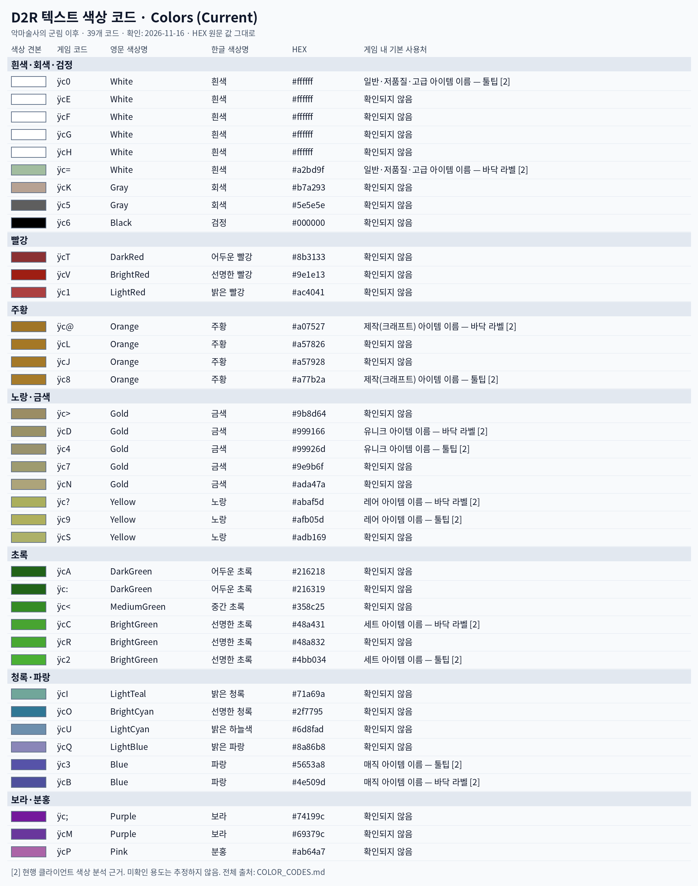
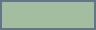
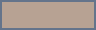
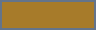
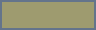
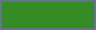
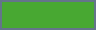
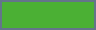
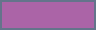

# Diablo II: Resurrected 텍스트 색상 코드



확인 날짜: **2026-11-16 (한국 시간)** · **39개 코드** · 기준: **악마술사의 군림(Reign of the Warlock) 이후 `Colors (Current)`** [1]. 구버전 `Colors (Old, Before RotW Expansion)`의 값은 사용하지 않았습니다.

견본은 원문 HEX를 그대로 RGB 픽셀로 만든 PNG입니다. 게임 화면을 측색한 결과가 아니며, 게임의 HDR·감마·표시 효과에 따른 화면상의 색까지 보장하지 않습니다. **UI 팔레트나 텍스트 색상을 바꾸는 모드를 사용하면 실제 색상은 달라질 수 있습니다.**

## 코드와 기본 사용처

표의 영문 이름은 원문을 유지했습니다. 비슷한 색끼리 묶었으며 그룹 안에서는 밝기·색조가 이어지도록 배치했습니다. 같은 이름·같은 HEX여도 게임 코드가 다르면 별도 행입니다. `White`로 명명된 `ÿc=`와 `Gray`로 명명된 `ÿcK`처럼 육안상 다른 색조가 섞여 보이는 항목도 원문 이름과 값을 임의로 고치지 않았습니다.

**기본 사용처의 ‘툴팁’과 ‘바닥 라벨’은 구분해야 합니다.** 현행 클라이언트 분석 [2]는 일반·매직·세트·레어·유니크·크래프트의 두 표시 위치에 서로 다른 색상 인덱스를 기록합니다. 아래 사용처는 이 분석에 근거하며, 필터가 새로 지정하는 색을 기본 용도로 옮겨 적지 않았습니다. 소켓·무형·룬워드 등 예외는 아래 확인 범위 참고.

### 흰색·회색·검정

| 색상 견본 | 게임 코드 | 영문 색상명 | 한글 색상명 | HEX | 게임 내 기본 사용처 |
|---|---|---|---|---|---|
|  | `ÿc0` | White | 흰색 | `#ffffff` | 일반·저품질·고급 아이템 이름 — 툴팁 [2] |
|  | `ÿcE` | White | 흰색 | `#ffffff` | 확인되지 않음 |
|  | `ÿcF` | White | 흰색 | `#ffffff` | 확인되지 않음 |
|  | `ÿcG` | White | 흰색 | `#ffffff` | 확인되지 않음 |
|  | `ÿcH` | White | 흰색 | `#ffffff` | 확인되지 않음 |
|  | `ÿc=` | White | 흰색 | `#a2bd9f` | 일반·저품질·고급 아이템 이름 — 바닥 라벨 [2] |
|  | `ÿcK` | Gray | 회색 | `#b7a293` | 확인되지 않음 |
|  | `ÿc5` | Gray | 회색 | `#5e5e5e` | 확인되지 않음 |
|  | `ÿc6` | Black | 검정 | `#000000` | 확인되지 않음 |

### 빨강

| 색상 견본 | 게임 코드 | 영문 색상명 | 한글 색상명 | HEX | 게임 내 기본 사용처 |
|---|---|---|---|---|---|
|  | `ÿcT` | DarkRed | 어두운 빨강 | `#8b3133` | 확인되지 않음 |
|  | `ÿcV` | BrightRed | 선명한 빨강 | `#9e1e13` | 확인되지 않음 |
|  | `ÿc1` | LightRed | 밝은 빨강 | `#ac4041` | 확인되지 않음 |

### 주황

| 색상 견본 | 게임 코드 | 영문 색상명 | 한글 색상명 | HEX | 게임 내 기본 사용처 |
|---|---|---|---|---|---|
|  | `ÿc@` | Orange | 주황 | `#a07527` | 제작(크래프트) 아이템 이름 — 바닥 라벨 [2] |
|  | `ÿcL` | Orange | 주황 | `#a57826` | 확인되지 않음 |
|  | `ÿcJ` | Orange | 주황 | `#a57928` | 확인되지 않음 |
|  | `ÿc8` | Orange | 주황 | `#a77b2a` | 제작(크래프트) 아이템 이름 — 툴팁 [2] |

### 노랑·금색

| 색상 견본 | 게임 코드 | 영문 색상명 | 한글 색상명 | HEX | 게임 내 기본 사용처 |
|---|---|---|---|---|---|
|  | `ÿc>` | Gold | 금색 | `#9b8d64` | 확인되지 않음 |
|  | `ÿcD` | Gold | 금색 | `#999166` | 유니크 아이템 이름 — 바닥 라벨 [2] |
|  | `ÿc4` | Gold | 금색 | `#99926d` | 유니크 아이템 이름 — 툴팁 [2] |
|  | `ÿc7` | Gold | 금색 | `#9e9b6f` | 확인되지 않음 |
|  | `ÿcN` | Gold | 금색 | `#ada47a` | 확인되지 않음 |
|  | `ÿc?` | Yellow | 노랑 | `#abaf5d` | 레어 아이템 이름 — 바닥 라벨 [2] |
|  | `ÿc9` | Yellow | 노랑 | `#afb05d` | 레어 아이템 이름 — 툴팁 [2] |
|  | `ÿcS` | Yellow | 노랑 | `#adb169` | 확인되지 않음 |

### 초록

| 색상 견본 | 게임 코드 | 영문 색상명 | 한글 색상명 | HEX | 게임 내 기본 사용처 |
|---|---|---|---|---|---|
|  | `ÿcA` | DarkGreen | 어두운 초록 | `#216218` | 확인되지 않음 |
|  | `ÿc:` | DarkGreen | 어두운 초록 | `#216319` | 확인되지 않음 |
|  | `ÿc<` | MediumGreen | 중간 초록 | `#358c25` | 확인되지 않음 |
|  | `ÿcC` | BrightGreen | 선명한 초록 | `#48a431` | 세트 아이템 이름 — 바닥 라벨 [2] |
|  | `ÿcR` | BrightGreen | 선명한 초록 | `#48a832` | 확인되지 않음 |
|  | `ÿc2` | BrightGreen | 선명한 초록 | `#4bb034` | 세트 아이템 이름 — 툴팁 [2] |

### 청록·파랑

| 색상 견본 | 게임 코드 | 영문 색상명 | 한글 색상명 | HEX | 게임 내 기본 사용처 |
|---|---|---|---|---|---|
|  | `ÿcI` | LightTeal | 밝은 청록 | `#71a69a` | 확인되지 않음 |
|  | `ÿcO` | BrightCyan | 선명한 청록 | `#2f7795` | 확인되지 않음 |
|  | `ÿcU` | LightCyan | 밝은 하늘색 | `#6d8fad` | 확인되지 않음 |
|  | `ÿcQ` | LightBlue | 밝은 파랑 | `#8a86b8` | 확인되지 않음 |
|  | `ÿc3` | Blue | 파랑 | `#5653a8` | 매직 아이템 이름 — 툴팁 [2] |
|  | `ÿcB` | Blue | 파랑 | `#4e509d` | 매직 아이템 이름 — 바닥 라벨 [2] |

### 보라·분홍

| 색상 견본 | 게임 코드 | 영문 색상명 | 한글 색상명 | HEX | 게임 내 기본 사용처 |
|---|---|---|---|---|---|
|  | `ÿc;` | Purple | 보라 | `#74199c` | 확인되지 않음 |
|  | `ÿcM` | Purple | 보라 | `#69379c` | 확인되지 않음 |
|  | `ÿcP` | Pink | 분홍 | `#ab64a7` | 확인되지 않음 |

## 기본 사용처의 확인 범위

- [2]는 블리자드 공식 명세가 아닌 **현행 클라이언트를 분석한 커뮤니티 소스**입니다. `LabelPlainColors`와 `TooltipPlainColors`는 필터의 사용자 색상 설정이 아니라 원래 게임 색과 비교하기 위한 기준 배열입니다. 아이템 품질과 색상 인덱스 매핑은 원문 주석과 배열을 함께 대조했습니다.
- 바닥 라벨의 일반/매직/세트/레어/유니크/크래프트 인덱스는 각각 **13/18/19/15/20/16**, 툴팁은 **0/3/2/9/4/8**입니다. 원문이 명시한 코드 변환(`코드 마지막 문자 − '0'`)에 따라 표에 반영했습니다.
- **소켓·무형 아이템:** [2]는 일반 품질 색상과 구분되는 회색 예외가 있음을 설명하지만, 해당 분기의 정확한 현행 코드/인덱스는 인용한 자료에서 확인되지 않습니다. 따라서 `ÿc5` 또는 `ÿcK`에 추정 배정하지 않았습니다. 무형 매직·유니크 등 모든 품질이 무조건 회색이라는 뜻도 아닙니다.
- **룬워드:** 이름이 금색이라는 이유만으로 `ÿc4`, `ÿc7`, `ÿcD` 등에 배정하지 않았습니다. 확인한 현행 자료에서 정확한 기본 코드를 특정하지 못했습니다.
- 룬·퀘스트 아이템·기타 UI와 예외적 표시 상태도 정확한 코드가 확인되지 않으면 사용처를 추가하지 않았습니다. ‘확인되지 않음’은 **미사용·작동 불가라는 뜻이 아닙니다.**
- 이 문서 작성 중 실제 게임에서 39개 코드나 모든 기본 사용처를 직접 재시험하지는 않았습니다. 과거 게임의 색상 용도·HEX를 현재 버전 근거로 대체하지 않았습니다.

## 커스텀 필터·문자열 활용 예시

아래는 사용자가 원하는 색을 직접 지정하는 예시이며 **기본 게임의 사용처가 아닙니다.**

```js
const hammerName = 'ÿc8룬 분해 망치'; // 커스텀 이름에 주황 코드 지정
const neutralLine = 'ÿc0추가 재료 없이 단독 조합'; // 다음 줄의 색상도 명시
const colorPrefix = '\u00ffc';
const customName = `${colorPrefix}P사용자 지정 이름`; // 현행 ÿcP는 Pink
```

`ÿ`는 **U+00FF**입니다. 복사할 때 `y`로 바꾸지 마세요. 문자열에 넣는 코드는 `ÿc` 뒤 한 글자이며, 색상 이름이나 HEX 자체를 게임 코드 자리에 넣는 방식이 아닙니다. `ÿcP` 등은 확장팩 이전 표와 의미가 다르므로 옛 표의 색상 이름으로 해석하지 마세요. 이 문서는 참고 자료만 추가하며 게임 필터·UI 팔레트·기존 모드 설정은 수정하지 않습니다.

## 출처와 재생성

1. **색상 코드·영문 이름·HEX:** [olegbl/d2rmm — D2R Text Color Codes / Colors (Current)](https://github.com/olegbl/d2rmm/blob/master/.claude/d2r-modding-api.md#d2r-text-color-codes). [확인한 고정 버전](https://github.com/olegbl/d2rmm/blob/826ace147d8ff2303cd7a4b323de25a477d9409c/.claude/d2r-modding-api.md#colors-current), 커밋 `826ace147d8ff2303cd7a4b323de25a477d9409c`. 같은 문서의 Old 표는 제외했습니다.
2. **현행 기본 아이템 이름 색상 인덱스:** [CelestialRayOne/d2rloader_plugins — loot-filter/plugin.cpp, 기본 색상 분석 주석](https://github.com/CelestialRayOne/d2rloader_plugins/blob/acf6e5ad5e248468c86b66876e1cea79ce33d62e/plugins/loot-filter/plugin.cpp#L140-L160), [원래 게임 색상 비교 배열](https://github.com/CelestialRayOne/d2rloader_plugins/blob/acf6e5ad5e248468c86b66876e1cea79ce33d62e/plugins/loot-filter/plugin.cpp#L1762-L1780). 확인한 고정 커밋 `acf6e5ad5e248468c86b66876e1cea79ce33d62e`. 필터의 재색칠 기능 자체를 기본 게임 동작이라고 취급하지 않았습니다.

데이터: [docs/color-codes.json](docs/color-codes.json) · 생성 도구: [tools/generate-color-codes.py](tools/generate-color-codes.py). Pillow와 Noto Sans CJK 글꼴을 사용해 `python3 tools/generate-color-codes.py`로 Markdown·전체 PNG·개별 견본 PNG를 함께 재생성합니다. 글꼴 경로는 스크립트 상단에 명시되어 있습니다. 색상 데이터는 수동으로 기본 사용처 근거를 확인한 뒤 갱신해야 합니다.
